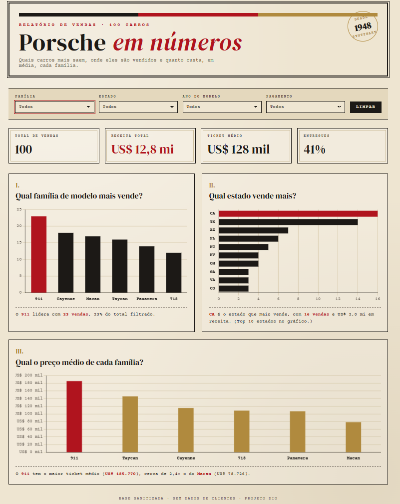
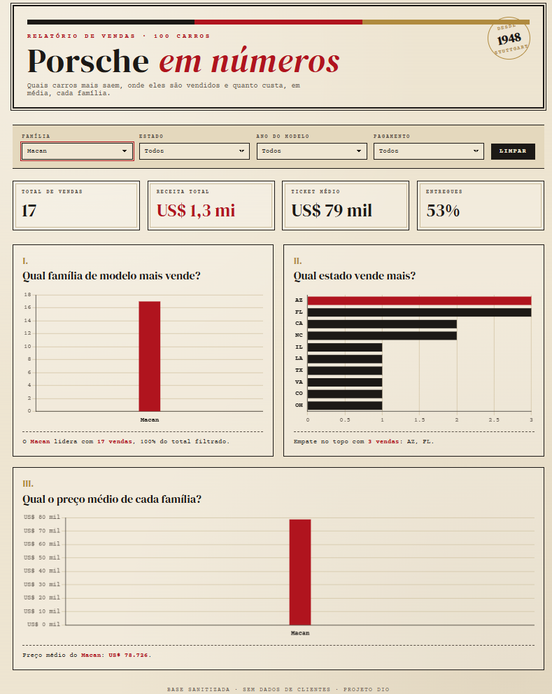

# Porsche em números · Dashboard de vendas

Dashboard interativa em HTML feita a partir de uma planilha com 100 vendas da Porsche, como projeto prático do curso da DIO sobre relatórios com IA.

🔗 **Dashboard publicada:** https://SEU-USUARIO.github.io/dashboard-porsche-vendas/

## Perguntas de negócio

| # | Pergunta | Como é respondida | Por que escolhi |
|---|----------|-------------------|-----------------|
| 1 | Qual família de modelo mais vende? | Gráfico de barras com a quantidade de vendas por família | Saber qual linha puxa o volume ajuda a decidir estoque e foco de marketing |
| 2 | Qual estado vende mais? | Gráfico de barras horizontais (top 10 estados) | Mostra onde estão os clientes e onde vale reforçar concessionárias |
| 3 | Qual o preço médio de cada família? | Gráfico de barras com o ticket médio | Vender muito não é o mesmo que faturar muito; o preço médio completa a leitura da pergunta 1 |

Abaixo de cada gráfico há uma frase que muda junto com os filtros, dizendo a resposta em texto.

**O que os dados mostraram (sem filtros):**
- O **911** é a família mais vendida (23 vendas) **e** a mais cara (ticket médio de ~US$ 186 mil), cerca de 2,4× o Macan.
- **Califórnia (16)** e **Texas (14)** concentram quase um terço das vendas.
- Receita total de **US$ 12,8 milhões**, com só **41%** das vendas já entregues.

## Indicadores e filtros

- **Indicadores de topo:** total de vendas, receita total, ticket médio e % de vendas entregues.
- **Filtros:** família, estado, ano do modelo e método de pagamento, com botão para limpar. Todos atualizam os indicadores e os três gráficos.

Exemplo de filtro aplicado (família = Macan):

## Tratamento da base

A planilha original tinha cada campo em duas versões (dado cru e sanitizado). Antes de ir para a IA:

1. **Fiquei só com as colunas sanitizadas.** O dado cru tinha preço escrito de vários jeitos (`$121k`, `USD 112.750`, `eighty two thousand USD`), ano por extenso (`twenty twenty four`) e estados ora em sigla, ora por extenso.
2. **Converti preço, ano e milhagem em número.**
3. **Removi o nome do cliente e do vendedor.** A base vai embutida no HTML, que é público, então não podia ter dado pessoal.
4. **Criei a coluna `familia`** (911, 718, Cayenne, Macan, Taycan, Panamera). Existem 40 modelos diferentes nas 100 vendas e o "mais vendido" tinha só 4 vendas, empatado com outros cinco. Agrupando por família, a resposta ficou clara.
5. **Não usei a data da venda como filtro**, porque 24 registros ficaram com data `INVALID` (como 30 de fevereiro ou 31 de abril). No lugar dela usei o **ano do modelo**.

O resultado está em [`base_tratada.csv`](base_tratada.csv).

## Prompt

O prompt completo e o que mudou nele até a versão final estão em [`prompt.md`](prompt.md).

## Ferramenta usada

Usei o **Claude** (Anthropic), no chat, em vez do ChatGPT com Canvas ou de um agente com skill. Fui conversando: primeiro analisamos a base juntos, depois ajustamos as perguntas com base no que os dados mostraram, e só então a dashboard foi gerada e testada no computador e no celular.

## Tecnologias

- HTML, CSS e JavaScript em um único arquivo (`index.html`)
- [Chart.js](https://www.chartjs.org/) para os gráficos
- Fontes DM Serif Display e Courier Prime (Google Fonts)
- Visual vintage inspirado em pôsteres antigos de corrida, com as cores do brasão da Porsche (preto, vermelho e dourado)

## Arquivos

| Arquivo | O que é |
|---------|---------|
| `index.html` | A dashboard |
| `base_tratada.csv` | Base depois do tratamento |
| `prompt.md` | Prompt usado e as mudanças |
| `print-dashboard.png` | Print da dashboard completa |
| `print-filtro-macan.png` | Print com filtro aplicado |
